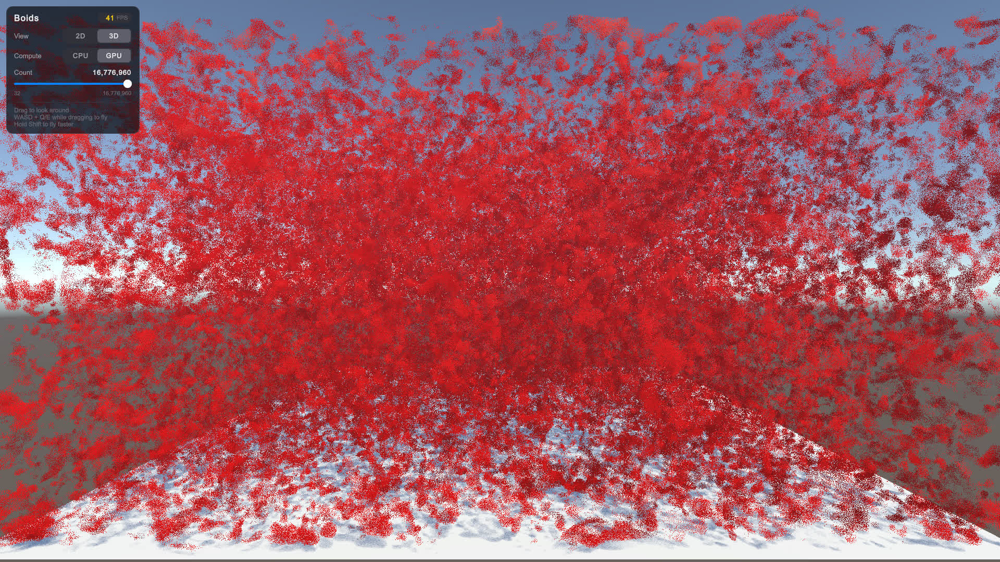
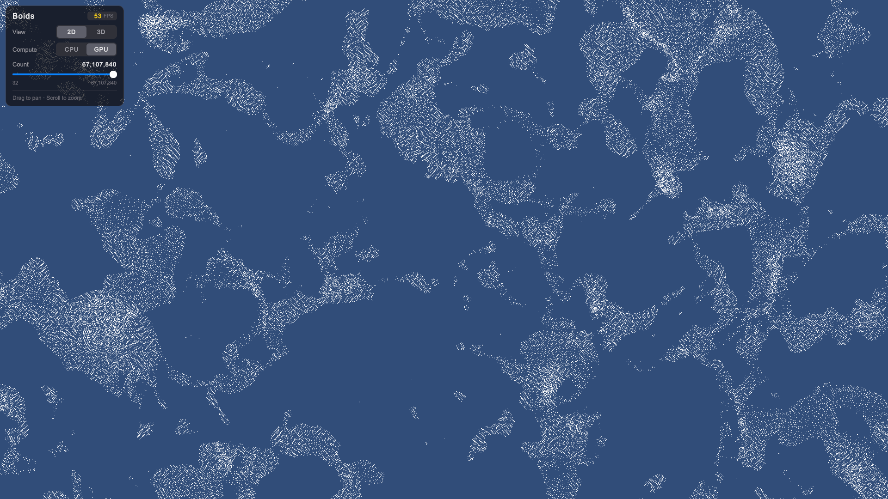

# 2D/3D Boids Flocking Simulation (CPU/GPU)

### See it in action here: [Boids](https://jtsorlinis.github.io/BoidsUnity/)

---

I wanted to learn about GPGPU and Compute shaders so ended up making a boid flocking simulation in unity.

I first made it in 2D on the CPU, then using Burst/Jobs, and eventually moved everything to the GPU, which brought an insane performance increase.

The simulation uses a uniform spatial grid as an acceleration structure to determine nearest neighbours, as brute force method would cap out at around 50k entities even on GPU.

Method used is inspired by this presentation: https://on-demand.gputechconf.com/gtc/2014/presentations/S4117-fast-fixed-radius-nearest-neighbor-gpu.pdf

